  

I build software for my own business and contribute to open source.

  
  &nbsp;
  

<!-- TOKSCALE:START -->

## AI coding activity

**139.89B tokens** recorded across Claude Code and Codex from June through November 20, 2026. The total includes cached input. [Measured with Tokscale](https://github.com/junhoyeo/tokscale)

<!-- TOKSCALE:END -->

## GitHub activity

